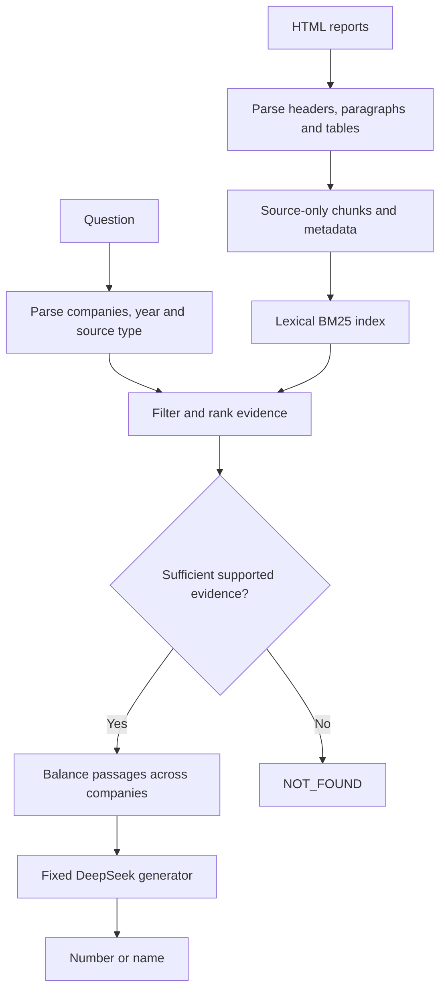

## Homework 4 solution

### Pipeline and design



My pipeline extracts the report company, fiscal year and document type from the HTML heading, serializes each table with its original caption, row labels, column labels and values, and keeps paragraphs and table rows in source-only chunks below 1,500 characters. Every chunk carries source, company, fiscal_year and doc_type metadata; contextual headers make the source and section explicit. A BM25 index uses financial tokenization without embeddings. The question parser identifies exact company names, including companies absent from the corpus, the requested year and the requested document type. Retrieval filters candidates by this metadata, recognizes that a requested year may be a prior-year column or a forecast, and ranks financial rows and personnel passages using their metric labels and captions. Per-company selection protects comparisons from retrieving passages about only one company. Evidence checks reject missing companies, unsupported years, undisclosed metrics and unsupported qualifiers; sufficient evidence is passed to the unchanged fixed generator, otherwise an empty list produces NOT_FOUND. This design addresses wrong-company matches, lost row/column bindings, outdated officers, forecasts and unsupported questions while avoiding extra model calls.

### Controlled experimental setup

All variants use the same 40 public documents and 60 questions, the same provided scoring functions, the same fixed generator (deepseek-v4-flash, temperature 0), and at most five retrieved chunks. BM25 k1=1.4 and b=0.65 are fixed across every row; B0 uses lower-cased whitespace tokens. The RecursiveCharacterTextSplitter has chunk_size=1200 and chunk_overlap=150 and stays unchanged until the chunking component is replaced. Every row retains the required document metadata. The teacher-supplied generator already formats metadata headers for every variant; V5 changes only the additional inline header inside chunk text. Every pre-V9 variant retains a global BM25 fallback when metadata yields no candidates, so abstention is introduced only at V9. V6 and V7 use identical candidate scores and equal maximum evidence budgets; only company allocation changes. V8 then changes the budget alone. For V9, a check asserts that all 60 retrieved passage lists exactly match the submitted implementation. Each adjacent feature vector differs in exactly one boolean component, verified before execution. No benchmark answers or evidence labels are used to select retrieved chunks; labels are read only for evaluation.

Python: 3.11.18. Submitted hw4.py SHA-256: `9561ac164aaacc631b151272c988785dc9bc61bdb8747ffb3f8e18dd6b893146`. The script verifies that this file and its teacher-provided section remain unchanged.

### Ablation results

**Status: offline ablation completed; online accuracy/time is not yet fully measured. This is a draft until all online runs finish.**

Recall@5 requires every needed fact of an answerable question to appear in retrieved evidence. Kept is the answerable retention rate; rejected is the unanswerable rejection rate. Offline time includes parsing, chunking, indexing, query parsing, retrieval and offline evaluation, but excludes generation. Online time covers the unchanged official main(), including generation; it excludes dependency installation and the separate offline diagnostic pass. All timings are one-run observations, not guarantees. Missing online values are not estimates.

| Variant | One change from preceding row | Chunks | Recall@5 | Comparison recall | Kept | Rejected | Parse | Offline points /55 | Offline s | Answer accuracy | Online s |
|---|---|---:|---:|---:|---:|---:|---:|---:|---:|---:|---:|
| B0 | Naive RAG baseline | 346 | 28.3% | 0.0% | 100.0% | 0.0% | 0.0% | 12.00 | 0.49 | Not measured | Not measured |
| V1 | HTML tables to labelled text | 368 | 26.1% | 8.3% | 100.0% | 0.0% | 0.0% | 20.00 | 0.94 | Not measured | Not measured |
| V2 | Financial tokenizer | 368 | 21.7% | 0.0% | 100.0% | 0.0% | 0.0% | 20.00 | 0.85 | Not measured | Not measured |
| V3 | Query parsing and metadata filter | 368 | 43.5% | 0.0% | 100.0% | 0.0% | 100.0% | 30.00 | 0.91 | Not measured | Not measured |
| V4 | HTML paragraphs and table-row chunks | 4308 | 47.8% | 0.0% | 100.0% | 0.0% | 100.0% | 30.00 | 1.70 | Not measured | Not measured |
| V5 | Contextual chunk headers | 4308 | 82.6% | 41.7% | 100.0% | 0.0% | 100.0% | 42.23 | 1.64 | Not measured | Not measured |
| V6 | Financial-metric ranking | 4308 | 100.0% | 100.0% | 100.0% | 0.0% | 100.0% | 45.00 | 2.05 | Not measured | Not measured |
| V7 | Per-company balanced selection | 4308 | 100.0% | 100.0% | 100.0% | 0.0% | 100.0% | 45.00 | 2.05 | Not measured | Not measured |
| V8 | Compact evidence budget | 4308 | 100.0% | 100.0% | 100.0% | 0.0% | 100.0% | 45.00 | 2.06 | Not measured | Not measured |
| V9 | Evidence-based abstention | 4308 | 100.0% | 100.0% | 100.0% | 100.0% | 100.0% | 55.00 | 1.73 | Not measured | Not measured |

B0 is the required naive baseline: BeautifulSoup.get_text(), no table conversion, RecursiveCharacterTextSplitter, required metadata, global whitespace-token BM25 top-5, no query parsing and no abstention. Its low Task 1.1 or 2.2 scores are expected baseline behavior, not a claim that these components were implemented incorrectly in the submitted final system.

### Analysis of each change

**B0 → V1 — HTML tables to labelled text.** Recall@5 changed by -2.2 percentage points; unanswerable rejection changed by +0.0 points. The only change is table serialization; the splitter, metadata, whitespace tokens and BM25 settings stay fixed. Labels and years become explicit, although repeated headers can also change lexical scores. Recall decreased in this controlled comparison; the regression is retained and reported. Repaired question IDs: q053; regressed IDs: q042, q059.

**V1 → V2 — Financial tokenizer.** Recall@5 changed by -4.3 percentage points; unanswerable rejection changed by +0.0 points. Only tokenization changes: financial words, numbers, stop words and plural normalization replace lower-cased whitespace tokens. Better matching is a hypothesis; the measured delta determines whether it helped here. Recall decreased in this controlled comparison; the regression is retained and reported. Repaired question IDs: q012, q026; regressed IDs: q002, q009, q038, q053.

**V2 → V3 — Query parsing and metadata filter.** Recall@5 changed by +21.7 percentage points; unanswerable rejection changed by +0.0 points. Only the query parser and metadata candidate filter are enabled. The requested year may be a prior-year table column or a forecast year, rather than the document fiscal year. Empty filters still use a global fallback, keeping abstention disabled. Repaired question IDs: q018, q020, q024, q030, q043, q046, q050, q051, q055, q057; regressed IDs: none.

**V3 → V4 — HTML paragraphs and table-row chunks.** Recall@5 changed by +4.3 percentage points; unanswerable rejection changed by +0.0 points. Only the chunking component changes to HTML paragraphs and table rows. Each financial row carries its caption and original column labels. Inline contextual headers remain disabled, so this comparison isolates chunk boundaries and row metadata. Repaired question IDs: q016, q045; regressed IDs: none.

**V4 → V5 — Contextual chunk headers.** Recall@5 changed by +34.8 percentage points; unanswerable rejection changed by +0.0 points. Only the inline contextual chunk header is added. Required metadata and the generator's existing metadata header are present in every variant. Extra inline text can help context but can also dilute lexical ranking. Repaired question IDs: q002, q003, q004, q009, q015, q021, q036, q038, q040, q042, q047, q052, q053, q054, q056, q059, q060; regressed IDs: q027.

**V5 → V6 — Financial-metric ranking.** Recall@5 changed by +17.4 percentage points; unanswerable rejection changed by +0.0 points. Only the candidate-ranking function changes. Original metric labels and table captions receive relevance bonuses; no candidate is rejected merely for lacking metric support yet, and balancing remains disabled. Repaired question IDs: q013, q017, q022, q023, q027, q031, q037, q058; regressed IDs: none.

**V6 → V7 — Per-company balanced selection.** Recall@5 changed by +0.0 percentage points; unanswerable rejection changed by +0.0 points. Only selection changes from globally merging company candidates to round-robin allocation per company. Candidate scores and the maximum evidence budget remain identical to V6; compare the comparison-category recall specifically. This run shows no marginal recall gain for this change; it should not be described as an improvement in recall.

**V7 → V8 — Compact evidence budget.** Recall@5 changed by +0.0 percentage points; unanswerable rejection changed by +0.0 points. Only the evidence budget changes: at most three passages for one company, or two per company in a two-company comparison. Candidate scoring, balanced allocation and the pre-abstention global fallback remain unchanged. This tests whether a smaller context can retain all required facts. This run shows no marginal recall gain for this change; it should not be described as an improvement in recall.

**V8 → V9 — Evidence-based abstention.** Recall@5 changed by +0.0 percentage points; unanswerable rejection changed by +100.0 points. Only evidence validation and abstention are enabled: exact entity availability, year/metric/qualifier support, and confidence pruning determine whether to return passages or an empty list. The global fallback is removed. Check kept together with rejected, because rejecting everything would score zero. This run shows no marginal recall gain for this change; it should not be described as an improvement in recall.

### Error analysis and limits

**q003 (comparison)** — Which company had more employees at 31 December 2024: Northgate Payments or Northgate Robotics? B0 missed required fact group(s) [1, 2] and retrieved company metadata ['Northgate Payments Corp.', 'Sablewood Retail Inc.']; V9 covered every required fact with company metadata ['Northgate Payments Corp.', 'Northgate Robotics Inc.']. The exact passages are in `public_results/B0/evidence.json` and `public_results/V9/evidence.json`. This is an observed retrieval failure, not proof of a wrong generated answer. Observed failure mechanism: no retrieved passage carries the required company metadata for Northgate Robotics.

**q004 (comparison)** — Which company had the higher net income in FY2024: Kestrel Semiconductor or Halcyon Freight? B0 missed required fact group(s) [1, 2] and retrieved company metadata ['Brightwater Software Inc.', 'Corvane Pharma Ltd.', 'Kestrel Semiconductor Ltd.']; V9 covered every required fact with company metadata ['Halcyon Freight Inc.', 'Kestrel Semiconductor Ltd.']. The exact passages are in `public_results/B0/evidence.json` and `public_results/V9/evidence.json`. This is an observed retrieval failure, not proof of a wrong generated answer. Observed failure mechanism: no retrieved passage carries the required company metadata for Halcyon Freight.

**q012 (table)** — How much long-term borrowing did Northgate Robotics report at 31 December 2024, in USD millions? B0 missed required fact group(s) [1] and retrieved company metadata ['Northgate Robotics Inc.']; V9 covered every required fact with company metadata ['Northgate Robotics Inc.']. The exact passages are in `public_results/B0/evidence.json` and `public_results/V9/evidence.json`. This is an observed retrieval failure, not proof of a wrong generated answer. Observed failure mechanism: required numeric text appears inside concatenated cell text rather than as a whole numeric value (838.4).

**q001 (unanswerable)** — How much cash and cash equivalents did Northgate Robotic Systems hold at 31 December 2025, in USD millions? B0 returned 5 passages despite the absent answer; V9 returned an empty list. The same before/after evidence files contain this case.

Remaining final retrieval/abstention failures on this public set: none. This does not establish private-set performance. Rules may fail on new wording, an unrecognized metric, or a different document layout.

Generated-answer errors were not measured in this offline run. Correct evidence does not guarantee that the fixed generator selects the right year, current officer, or forecast revision.

| Variant | Answerable retrieval misses /46 | False abstentions /46 | Unanswerable false keeps /14 | Wrong answer with retrieval hit | Wrong answer with retrieval miss | Unanswerable wrong answers |
|---|---:|---:|---:|---:|---:|---:|
| B0 | 33 | 0 | 14 | Not measured | Not measured | Not measured |
| V1 | 34 | 0 | 14 | Not measured | Not measured | Not measured |
| V2 | 36 | 0 | 14 | Not measured | Not measured | Not measured |
| V3 | 26 | 0 | 14 | Not measured | Not measured | Not measured |
| V4 | 24 | 0 | 14 | Not measured | Not measured | Not measured |
| V5 | 8 | 0 | 14 | Not measured | Not measured | Not measured |
| V6 | 0 | 0 | 14 | Not measured | Not measured | Not measured |
| V7 | 0 | 0 | 14 | Not measured | Not measured | Not measured |
| V8 | 0 | 0 | 14 | Not measured | Not measured | Not measured |
| V9 | 0 | 0 | 0 | Not measured | Not measured | Not measured |

One cumulative run per variant cannot establish statistical significance or isolate interactions among components beyond the chosen order. In particular, equal Recall@5 does not establish equal answer accuracy, and perfect public results do not establish private performance. The small, structured fictional corpus favors rule-based metric and entity handling; a broader corpus could require more robust parsing or semantic retrieval, which is outside this assignment's rules.

### Reproduction and evidence

Install the original requirements, set DEEPSEEK_API_KEY in the local .env, then run:

```powershell
python task5_ablation.py --project . --online --write-readme
```

The script runs ten variants sequentially in isolated subprocesses, each with a 29-minute external limit. A timed-out or failed run is marked incomplete and is not reused as a valid result. Ten experiments may take more than 30 minutes in total; the assignment's limit applies to each run. No model, prompt, scoring function, teacher runner or submitted student source file is changed. Only the five permitted student function bindings change temporarily inside each experimental process.

Evidence directory: `public_results/`. Each variant contains `results_offline.csv`, `evidence.json`, `metrics.json` and `run_log.txt`. After an online run it additionally contains the official runner's `results.csv` with generated answers and correctness flags. `ablation_summary.csv` aggregates the measured values. Commit the script, README report and the experiment results used in the table; never commit .env or index files.
